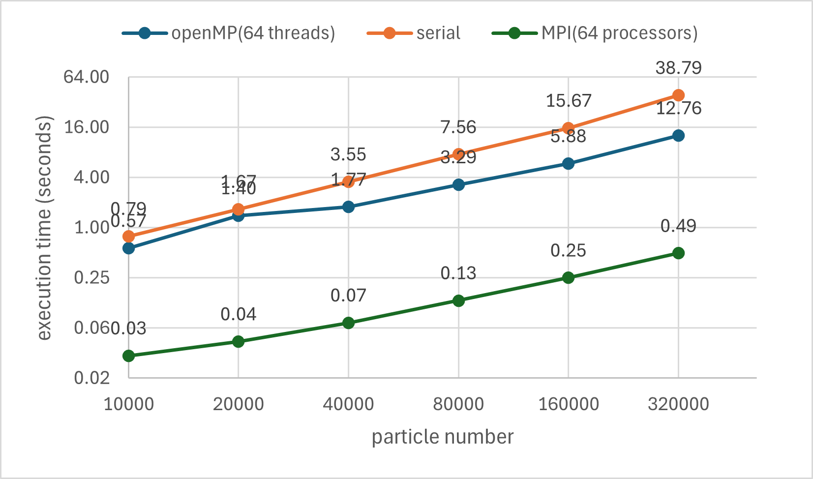
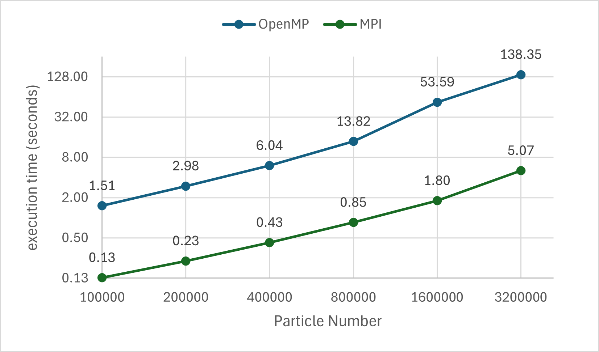
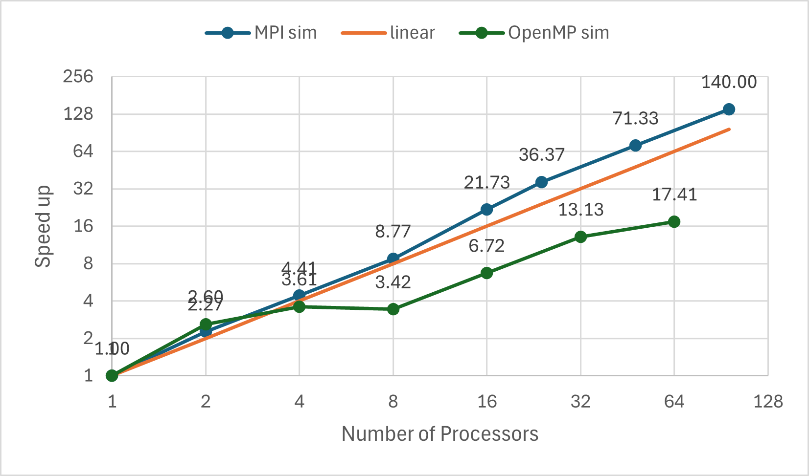
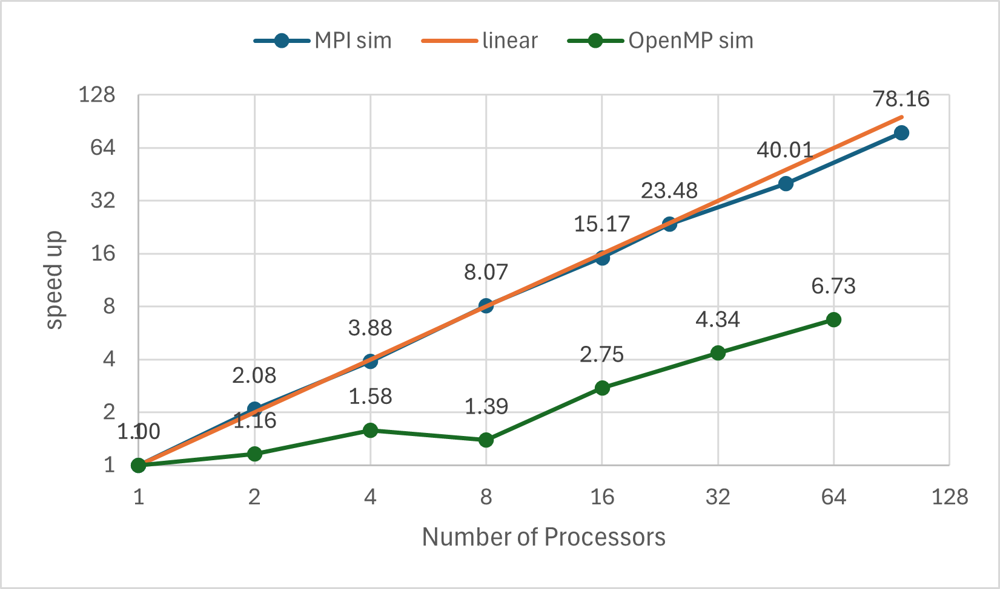

# Parallel Particle Simulation: OpenMP and MPI

A 2-D short-range particle simulation, sped up two ways: with **OpenMP** on a single shared-memory node and with **MPI** across multiple nodes of a Slurm cluster.

| | Speedup | Hardware | Baseline |
|---|---|---|---|
| OpenMP | **17×** | 64 cores, 1 node | optimized serial code |
| MPI | **110×** | 96 processes, 4 nodes | optimized serial code |

Both versions were checked against reference outputs for correctness.

> Source code is kept private because this was a course project. It is available on request.

---

## The problem

Particles move in a square box and push each other away, but only when two particles are closer than a fixed **cutoff** distance. Each of the 1,000 time steps computes the force on every particle and then moves all particles.

Checking every pair of particles costs O(n²) per step. Since only nearby particles interact, the work can be cut to O(n).

## Shared idea: spatial grid

The box is divided into square cells whose side is at least the cutoff. A particle can then only interact with particles in its own cell and the 8 cells around it, so each particle checks a small, nearly constant number of neighbors. This brings the cost per step from O(n²) down to O(n).

Each cell keeps its particles in a **linked list**: one array stores the first particle of each cell, and another stores, for each particle, the next particle in the same cell.

## OpenMP version (shared memory)

- All threads share one particle array and one grid.
- The force loop and the move loop are split across threads with static scheduling. Computing forces only reads the grid, so it needs no synchronization.
- After moving, particles that changed cells are relinked into their new cell. Two threads can touch the same cell at once, so each cell has its own lock (**fine-grained locking**). A thread moving a particle locks both the old and the new cell, always in increasing index order, which rules out deadlock.

## MPI version (distributed memory)

Each process has its own private memory, so particles have to be divided among processes, and anything a process needs from another must be sent as a message.

**Domain decomposition.** The box is split into horizontal strips of grid rows, one strip per process. Each particle is owned by exactly one process: the one whose strip contains it.

**Each step:**

1. **Ghost exchange.** Particles near a strip boundary feel forces from particles across it. Each process sends copies of the particles in its top and bottom rows to its two neighbors. Only positions are sent (16 bytes instead of 56), because computing a force only needs the neighbor's position.
2. **Grid construction.** Each process rebuilds the linked-list grid for its strip plus one ghost row on each side.
3. **Force computation and move,** only for owned particles. Ghost copies are read but never modified, so no forces need to be sent back.
4. **Handoff.** Particles that moved out of a strip are removed and sent, complete, to the neighbor that now owns them.

**Communication.** All exchanges are only with the two neighboring processes, using non-blocking `MPI_Isend` / `MPI_Irecv` followed by a single `MPI_Waitall`, which cannot deadlock. Because a receiver can't know in advance how many particles will arrive, each exchange first sends the count, then the data. To save output, all particles are collected on one process with `MPI_Gatherv` and restored to their original order in O(n).

## Results

### Runtime versus problem size

On a log-log scale all versions have a slope close to 1: doubling the number of particles roughly doubles the runtime, confirming O(n) behavior. The parallel versions shift the line down, and MPI stays well below OpenMP as the problem grows to 3.2M particles.

### Strong scaling: same problem, more cores

| MPI processes | 1 | 2 | 4 | 8 | 16 | 24 | 48 | 96 |
|---|---|---|---|---|---|---|---|---|
| Time (s) | 74.28 | 32.79 | 16.84 | 8.47 | 3.42 | 2.04 | 1.04 | 0.53 |
| Speedup | 1.0 | 2.3 | 4.4 | 8.8 | 21.7 | 36.4 | 71.3 | 140.0 |

| OpenMP threads | serial | 2 | 4 | 8 | 16 | 32 | 64 |
|---|---|---|---|---|---|---|---|
| Time (s) | 58.51 | 22.51 | 16.22 | 17.09 | 8.71 | 4.46 | 3.36 |
| Speedup | 1.0 | 2.6 | 3.6 | 3.4 | 6.7 | 13.1 | 17.4 |

MPI speedup is above linear. With one process, the data for 500K particles does not fit in cache, so each particle is slow to process. Split across many processes, each process's share fits in cache. Single-process runs show this directly: the time per particle per step grows from about 77 ns at 5K particles to about 149 ns at 500K, even though the algorithm is O(n).

OpenMP scales well below linear and stalls between 4 and 8 threads. All threads share one memory system and one grid, and moving particles between cells requires locks, so adding threads runs into memory bandwidth and lock contention rather than adding proportional speed.

### Weak scaling: problem grows with the cores

| MPI processes | 1 | 2 | 4 | 8 | 16 | 24 | 48 | 96 |
|---|---|---|---|---|---|---|---|---|
| Time (s) | 0.83 | 0.80 | 0.86 | 0.83 | 0.88 | 0.85 | 1.00 | 1.02 |

With MPI, the problem grows 96× and runtime rises only 23% (81% efficiency). Runtime stays flat within one node and rises once processes span multiple nodes and messages travel over the network.

OpenMP's runtime, by contrast, grows several times over as threads and problem size increase together, reaching a scaled speedup of only 6.7× on 64 threads. Each MPI process works on its own private data, while OpenMP threads compete for the same shared memory, which is why the distributed version scales much further.

### Where the time goes

Timing each phase on every process shows that computation dominates: about 90% of the runtime at 400K particles and above on 96 processes. Communication and waiting take a growing share as the number of processes rises. On small problems, communication becomes the limit. With 5K particles, going from 24 to 96 processes made the run only 1.3× faster, because each step is already close to the fixed latency of exchanging messages with neighbors.

## Design choices

**Linked list vs. counting sort for the grid.** I first stored each cell's particles contiguously using a counting sort, then switched to linked lists. The linked list was about 31% faster on one process (74 s vs. 107 s). Particles are sparse, about 0.2 per cell, so there are roughly 5× more cells than particles. Counting sort makes three passes over the cell array each step; the linked list makes one. Lists are so short that the linked list's usual drawback, scattered memory access, barely matters.

**1-D strips instead of 2-D blocks.** Strips mean only two neighbors and simple exchanges. The cost is that each strip spans the full width of the box, so the data each process exchanges grows as the problem grows. A 2-D block decomposition would keep that constant.

## What I would do next

- **2-D block decomposition**, to stop communication from growing with the problem size in weak scaling.
- **Overlap communication with computation.** Particles away from strip boundaries don't need ghosts, so their forces can be computed while ghost messages are in flight.
- **Fewer message rounds per step,** for example by merging the count and data messages, to reduce latency on small problems.

## Tools

C++, OpenMP, MPI, CMake, Slurm.
